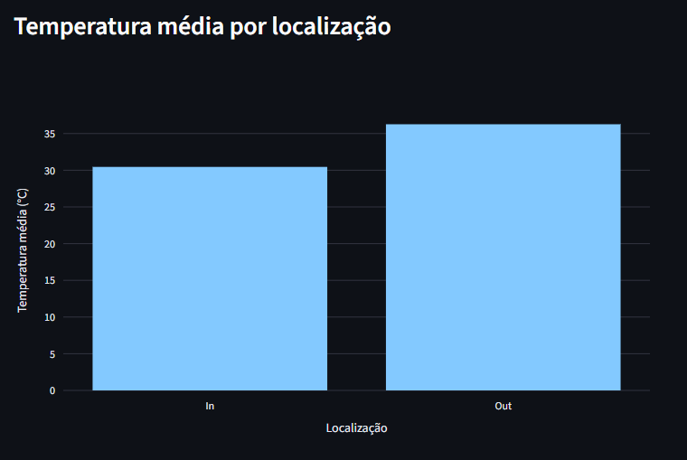
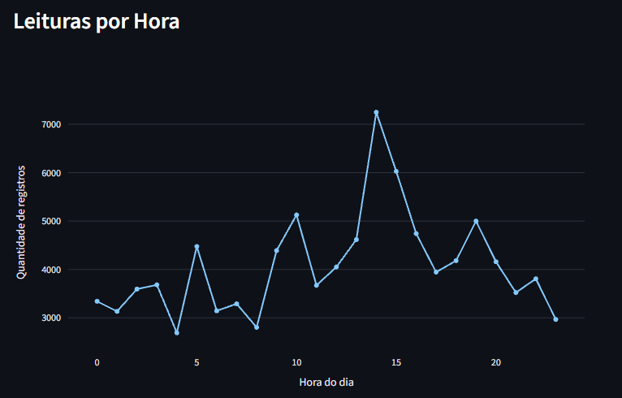
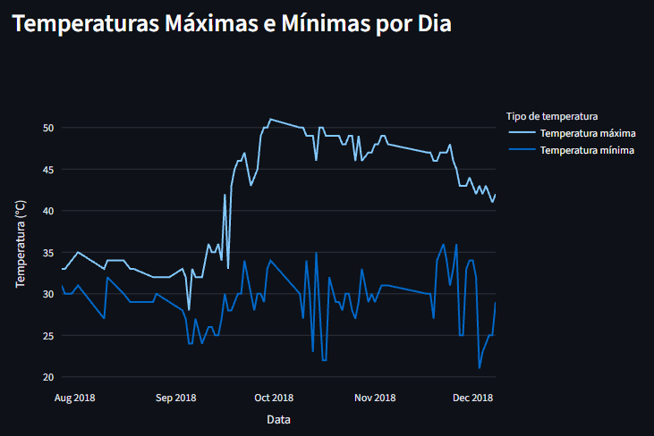

# Pipeline de dados IoT com PostgreSQL e Docker

Este projeto consiste no desenvolvimento de um pipeline de dados para leitura, processamento, armazenamento e visualização de dados de temperatura provenientes de dispositivos IoT. Desenvolvido no contexto da disciplina de Disruptive Architectures: IoT, Big Data e IA, o projeto utiliza Python para processamento dos dados, PostgreSQL para armazenamento, Docker para execução do banco de dados e Streamlit para construção de um dashboard interativo.

O projeto utiliza um conjunto de dados de leituras de temperatura, disponibilizado na plataforma Kaggle, para construir um fluxo de dados que vai desde a leitura de um arquivo CSV até a geração de visualizações para análise por meio de gráficos. Também foram criadas três views SQL para organizar as consultas e facilitar a apresentação dos resultados no dashboard.


## Escopo do projeto

O projeto foi desenvolvido com foco em:

- Leitura e processamento de dados de um arquivo CSV.
- Configuração de ambiente utilizando Python.
- Armazenamento dos registros em um banco de dados PostgreSQL.
- SQLAlchemy para realizar conexão ao PostgreSQL.
- Execução do banco de dados em um container Docker.
- Criação de três views SQL para análise dos dados.
- Desenvolvimento de um dashboard interativo utilizando Streamlit e Plotly.
- Versionamento com Git.

Além deste pontos principais, a criação desse projeto também prioriza uma estrutura simples e organizada, permitindo a compreensão de cada etapa do pipeline e tambem a reprodução em outros ambientes a partir de instruções claras.


## Tecnologias e ferramentas utilizadas

Linguagens e bibliotecas:

- Python: linguagem utilizada para leitura, processamento e integração dos dados.
- SQL: linguagem utilizada para consultas e criação das views no PostgreSQL.
- pandas: leitura e manipulação dos dados do CSV.
- SQLAlchemy: conexão entre Python e PostgreSQL e execução de consultas.
- Streamlit: construção da interface do dashboard.
- Plotly Express: criação dos gráficos interativos.

Infraestrutura e ferramentas:

- PostgreSQL 16: armazenamento dos dados processados.
- Docker e Docker Compose: execução e gerenciamento do banco de dados em container.
- Poetry: gerenciamento das dependências do projeto.
- Visual Studio Code: ambiente de desenvolvimento.


## Base de dados

O projeto utiliza o conjunto de dados Temperature Readings: IoT Devices, disponibilizado no Kaggle. Esse conjunto contém registros de temperatura que incluem informações como identificador (id), data e hora da leitura, temperatura e localização interna ou externa e possui mais de 97 mil registros.

Durante o processamento, algumas colunas foram renomeadas para facilitar a criação e utilização no banco de dados, por exemplo a coluna `room_id/id` que foi renomeada para `room_id`, e `out/in` passa a se chamar `location_type`.

- **Link para download do conjunto de dados:** https://www.kaggle.com/datasets/atulanandjha/temperature-readings-iot-devices


## Arquitetura do projeto

Este pipeline foi estruturado separando algumas das principais responsabilidades em diferentes arquivos, essa organização facilita a compreensão, manutenção e evolução do projeto.

Entre os principais arquivos e pastas temos:

- **data/:** Pasta que armazena o arquivo CSV utilizado como fonte dos dados.
- **src/:** Pasta que armazena os arquivos Python.
    - **database.py:** Arquivo responsável pela conexão com o PostgreSQL e criação da tabela temperature_readings.
    - **process_data.py:** Arquivo responsável pelo processamento e a inserção dos registros no banco de dados.
    - **dashboard.py:** Arquivo responsável pelas consultas das views e criação dos gráficos do dashboard.
- **sql/views.sql:** Arquivo que contém os comandos SQL para criação das três views.
- **docker-compose.yml:** Arquivo que define a configuração do container PostgreSQL e do volume utilizado para persistência dos dados.
- **pyproject.toml:** Arquivo onde são definidas as dependências e as configurações do projeto Poetry.
- **poetry.lock:** Arquivo que registra as versões resolvidas das dependências.
- **docs/images/:** Pastas criadas para armazenar as capturas de tela que serão apresentadas na seção sobre o dashboard e gráficos deste README.


## Instruções para execução do projeto

### Pré-requisitos

Antes de executar o projeto, é necessário ter instalado:

- Git.
- Docker Desktop.
- Python 3.12.
- Poetry.

### 1. Clonar o repositório

No terminal, utilize os comandos abaixo para clonar o projeto e acessar a pasta da aplicação:

```bash
git clone https://github.com/Lais-Cassiano/PipelineDeDadosIoT_DisruptiveArchitectures-UniFECAF.git
cd pipeline_dados_iot
```

### 2. Instalar as dependências

No terminal, ainda na raiz do projeto, utilize o comando:

```bash
poetry install
```

Esse comando instala as dependências declaradas no projeto e registradas no arquivo poetry.lock.

### 3. Iniciar o PostgreSQL com Docker

No terminal, com o Docker Desktop aberto, utilize o comando:

```bash
docker compose up -d
```

E depois para verificar se o container está em execução:

```bash
docker compose ps
```

O serviço PostgreSQL utiliza a imagem `postgres:16` e disponibiliza a porta `5432` para acesso local.

### 4. Criar a tabela no PostgreSQL

Com o container em execução no Docker, utilize o comando:

```bash
poetry run python src/database.py
```

O script `database.py` cria a tabela `temperature_readings` com as colunas necessárias para armazenar os dados de leituras de temperatura.

### 5. Processar e importar dados

Utilize o comando:

```bash
poetry run python src/process_data.py
```

O script `process_data.py` lê o arquivo CSV, renomeia as colunas necessárias, converte os valores de data e hora para o formato adequado e insere os registros na tabela criada anteriormente.

### 6. Criar as views SQL

Com os dados importados, utilize no terminal o comando:

```bash
Get-Content .\sql\views.sql | docker exec -i pipeline_dados_iot_postgres psql -U postgres -d iot_database
```

O comando, a partir do arquivo `views.slq`, cria as views que serão utilizdas pelo dashboard.

### 7. Executar o dashboard

Com o PostgreSQL ainda em execução no docker, utilize o comando:

```bash
poetry run streamlit run src/dashboard.py
```

O streamlit deverá abrir um endereço local autoamticamente, ou o mesmo se encontra dentro do próprio terminal, normalmente algo como:

```text
http://localhost:8501
```

Acesse o endereço no navegador para visualizar os treês gráficos.

### 8. Encerrar a execução

Para parar o dashboard, utilize `Ctrl + C` no terminal que está rodando o Streamlit.

Para parar e remover o container do projeto, utilize o comando:

```bash
docker compose down
```

Esse comando preserva o volume do PostgreSQL, mantendo os dados armazenados para a próxima execução.

Porém para remover também o volume e apagar os dados persistidos, utilize:

```bash
docker compose down -v
```

O arquivo CSV e os demais arquivos como os scripts, permanecem na pasta do projeto. Caso esse comando seja utilizado, ao querer visualizar o dashboard com todos os gráficos, será necessária retomar os passos da criação da tabela, inserção dos dados e criação das views SQL. 


## Views SQL e os gráficos

O dashboard foi desenvolvido com Streamlit e Plotly, permitindo visualizar os resultados das consultas SQL por meio de três gráficos. Para isso, foram criadas três views no PostgreSQL, cada uma com uma finalidade específica de análise dos dados de temperatura.

### 1. Temperatura média por localização

A view `avg_temperature_location` agrupa os registros pelo tipo de localização (location_type) e calcula a média da temperatura (temp) em cada grupo. O objetivo é comparar as temperaturas médias registradas em ambientes internos (In) e externos (Out). 

Para representar esses resultados, foi utilizado um gráfico de barras, que facilita a comparação entre as médias de temperatura dos dois grupos.



**Possíveis insights:**
- Comparar a temperatura média entre ambientes internos e externos.
- Observar possíveis diferenças de temperatura conforme o tipo de localização registrado nos dados.

### 2. Quantidade de registros por hora

A view `readings_per_hour` agrupa os registros de acordo com a hora do dia, utilizando a informação de data e hora (noted_date), e calculando a quantidade de leituras registradas em cada horário.

Para visualizar esses resultados, foi utilizado um gráfico de linhas, que permite observar como os registros estão distribuídos ao longo das 24 horas, durante todo o período monitorado.



**Possíveis insights:**
- Identificar os horários com maior e menor quantidade de registros.
- Observar padrões na distribuição dessas leituras.

### 3. Temperaturas mínima e máxima por dia

A view `daily_temperature_extremes` agrupa os registros pela data (noted_date) e calcula a menor e a maior temperatura (temp) registrada em cada dia.

Para apresentar os resultados, foi utilizado um gráfico de linhas com duas séries: uma para as temperaturas mínimas e outra para as temperaturas máximas. Dessa forma, é possível acompanhar a variação dos extremos de temperatura ao longo do período analisado.



**Possíveis insights:**
- Observar a variação dos extremos de temperatura ao longo do período.
- Comparar a diferença entre a temperatura mínima e a máxima de cada dia.
- Identificar os dias com as menores e maiores temperaturas registradas.


## Versionamento com Git

O Git foi utilizado para controlar as alterações do projeto e o GitHub para hospedar este repositório.

Os principais comandos utilizados para versionar e publicar as alterações foram:

1. Para iniciar o repositório;

```bash
git init
```

2. Para conectar ao repositório criado no GitHub;

```bash
git branch -M main
git remote add origin https://github.com/Lais-Cassiano/PipelineDeDadosIoT_DisruptiveArchitectures-UniFECAF.git
```

3. Para subir os códigos para o repositório pela primeira vez;

```bash
git add .
git commit -m "Descrição do commit que está sendo realizado"
git push -u origin main
```

4. Próximos commits;

```bash
git add .
git commit -m "Descrição do commit que está sendo realizado"
git push
```


## Licença

- Este projeto está licenciado sob a licença MIT:

Copyright 2026 Lais

Permission is hereby granted, free of charge, to any person obtaining a copy of this software and associated documentation files (the "Software"), to deal in the Software without restriction, including without limitation the rights to use, copy, modify, merge, publish, distribute, sublicense, and/or sell copies of the Software, and to permit persons to whom the Software is furnished to do so, subject to the following conditions:

The above copyright notice and this permission notice shall be included in all copies or substantial portions of the Software.

THE SOFTWARE IS PROVIDED "AS IS", WITHOUT WARRANTY OF ANY KIND, EXPRESS OR IMPLIED, INCLUDING BUT NOT LIMITED TO THE WARRANTIES OF MERCHANTABILITY, FITNESS FOR A PARTICULAR PURPOSE AND NONINFRINGEMENT. IN NO EVENT SHALL THE AUTHORS OR COPYRIGHT HOLDERS BE LIABLE FOR ANY CLAIM, DAMAGES OR OTHER LIABILITY, WHETHER IN AN ACTION OF CONTRACT, TORT OR OTHERWISE, ARISING FROM, OUT OF OR IN CONNECTION WITH THE SOFTWARE OR THE USE OR OTHER DEALINGS IN THE SOFTWARE.